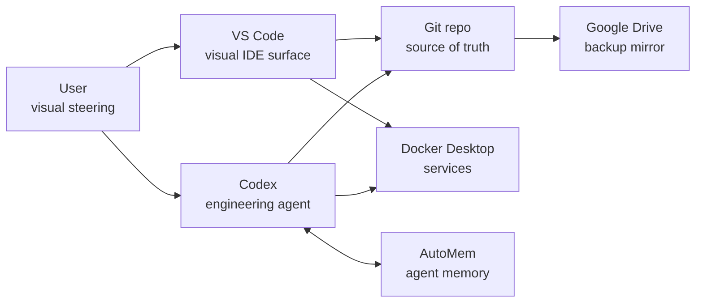

# Codex And VS Code Integration

Goal: make VS Code a native visual workbench for the local Codex workflow
without bypassing sandboxing, Git review, or memory boundaries.

## Division Of Labor

## What VS Code Should Do

- Show `VISUAL_MAP.md`, `TASKS.md`, `AGILE.md`, and `MODEL_LIMITATIONS.md`.
- Preview Mermaid diagrams.
- Show Git diffs before push.
- Show Docker containers for AutoMem, observatory, and backup-runner.
- Expose trusted workspace MCP servers from `.vscode/mcp.json` to VS Code
  chat/agent surfaces.
- Run workspace tasks for status checks and manual backups.
- Provide spellcheck, Markdown linting, ShellCheck, shell formatting, and
  PowerShell tooling as quiet local feedback.

## What Codex Should Do

- Make code and document edits.
- Use `apply_patch` for manual file changes.
- Run verification commands.
- Use linter/spellcheck feedback as useful external signal, not as absolute
  truth.
- Keep commits small and meaningful.
- Store durable decisions in AutoMem.
- Avoid leaking secrets or private archives to external tools.

## What We Avoid

- Installing unofficial Codex-like VS Code extensions without verification.
- Letting VS Code extensions become the source of truth.
- Bypassing Codex sandboxing by moving risky actions into GUI clicks.
- Depending on connector state when Git/Markdown is enough.

## Current VS Code Tasks

Use Command Palette -> `Tasks: Run Task`.

- `Theseus: git status`
- `Theseus: AutoMem status`
- `Theseus: Observatory status`
- `Theseus: Backup runner status`
- `Theseus: Export CodeWhale context`
- `Theseus: Create data backup now`

## VS Code MCP Boundary

VS Code 1.128 supports MCP configuration through `.vscode/mcp.json` and
`code --add-mcp`. This is the preferred way to let the VS Code/Copilot agent
use the same allowlisted local tools as Codex.

Current workspace MCP servers:

- `theseus-docker-tcp`: Docker control through
  `tools/docker_control_plane/direct_bridge.mjs` and
  `DOCKER_HOST=tcp://127.0.0.1:2375`.

Important boundary: VS Code MCP gives tools to the VS Code agent. It does not
by itself give Codex a reliable API to press VS Code buttons or read VS Code
chat results. For Codex-to-user-context actions, keep using one of these
bridges:

1. a VS Code task the user starts or allows on folder open,
2. a small file-queue worker such as `tools/vscode_bridge/bridge.mjs`,
3. a future direct VS Code agent-host integration after it is proven.

## VS Code Agent Host Probe

VS Code 1.128 includes an experimental `code agent` CLI:

- `code agent host`
- `code agent ps --json`
- `code agent logs <session>`

The matching protocol is Microsoft Agent Host Protocol (AHP). It is promising
because it is meant to synchronize agent sessions across IDE, web, CLI, and
other clients, but the public documentation marks it as active-development and
not yet stable.

Local probe:

- `tools/vscode_ahp/ahp_probe.mjs`
- VS Code tasks:
  - `Theseus VS Code AHP: status`
  - `Theseus VS Code AHP: ps`
  - `Theseus VS Code AHP: host local`
  - `Theseus VS Code AHP: host replace local`

Use this as an experiment, not as the only bridge. Keep MCP and the file-queue
worker available until AHP behavior is proven in this workspace.

## Preferred Session Layout

Left sidebar:

1. Explorer
2. Source Control
3. Docker

Open editors:

1. `VISUAL_MAP.md`
2. `TASKS.md`
3. `MODEL_LIMITATIONS.md`
4. Current working file

This makes VS Code the user's cockpit while Codex remains the careful engineer.
