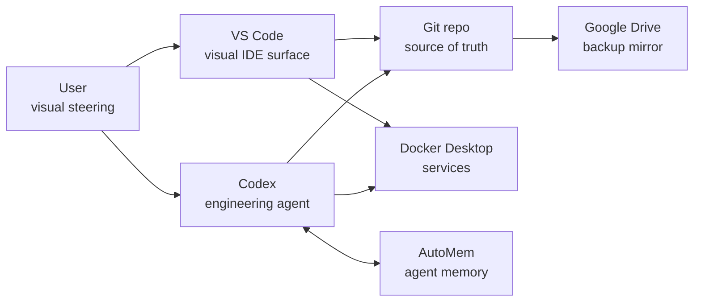

# Codex And VS Code Integration

Goal: make VS Code a native visual workbench for the local Codex workflow
without bypassing sandboxing, Git review, or memory boundaries.

## Division Of Labor

## What VS Code Should Do

- Show `VISUAL_MAP.md`, `TASKS.md`, `AGILE.md`, and `MODEL_LIMITATIONS.md`.
- Preview Mermaid diagrams.
- Show Git diffs before push.
- Show Docker containers for AutoMem, observatory, and backup-runner.
- Run workspace tasks for status checks and manual backups.
- Provide spellcheck, Markdown linting, ShellCheck, shell formatting, and
  PowerShell tooling as quiet local feedback.

## What Codex Should Do

- Make code and document edits.
- Use `apply_patch` for manual file changes.
- Run verification commands.
- Use linter/spellcheck feedback as useful external signal, not as absolute
  truth.
- Keep commits small and meaningful.
- Store durable decisions in AutoMem.
- Avoid leaking secrets or private archives to external tools.

## What We Avoid

- Installing unofficial Codex-like VS Code extensions without verification.
- Letting VS Code extensions become the source of truth.
- Bypassing Codex sandboxing by moving risky actions into GUI clicks.
- Depending on connector state when Git/Markdown is enough.

## Current VS Code Tasks

Use Command Palette -> `Tasks: Run Task`.

- `Theseus: git status`
- `Theseus: AutoMem status`
- `Theseus: Observatory status`
- `Theseus: Backup runner status`
- `Theseus: Export CodeWhale context`
- `Theseus: Create data backup now`

## Preferred Session Layout

Left sidebar:

1. Explorer
2. Source Control
3. Docker

Open editors:

1. `VISUAL_MAP.md`
2. `TASKS.md`
3. `MODEL_LIMITATIONS.md`
4. Current working file

This makes VS Code the user's cockpit while Codex remains the careful engineer.
