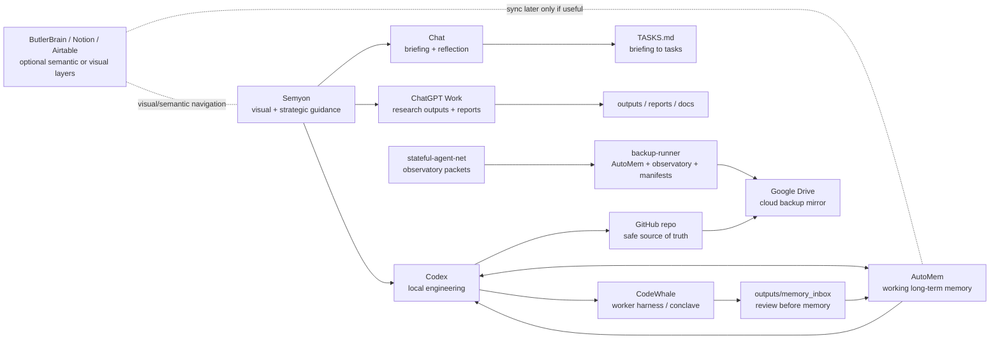
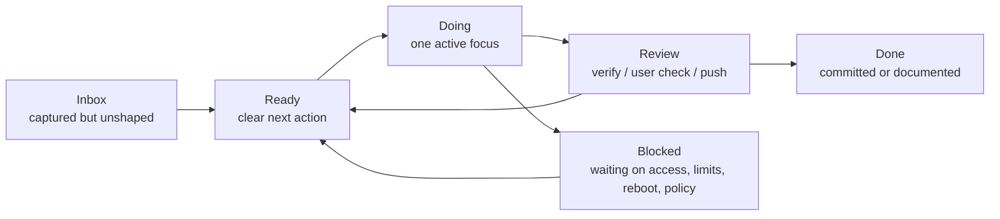
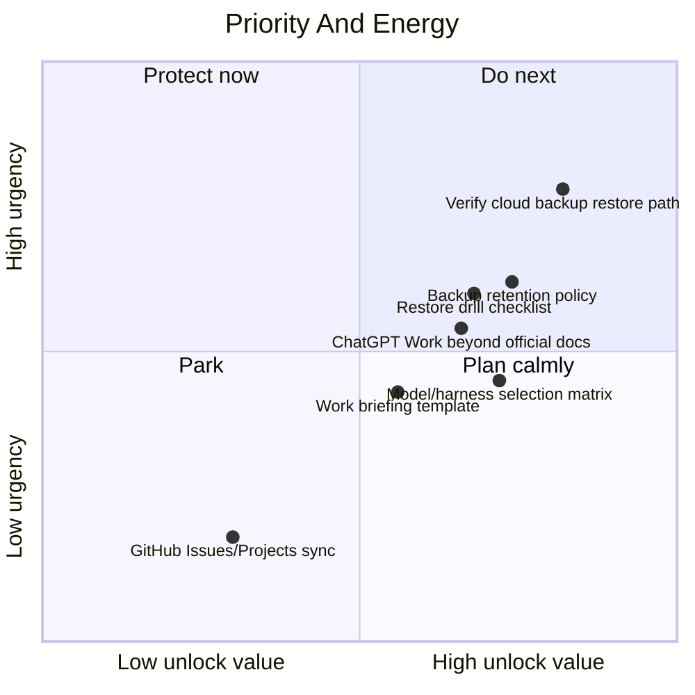
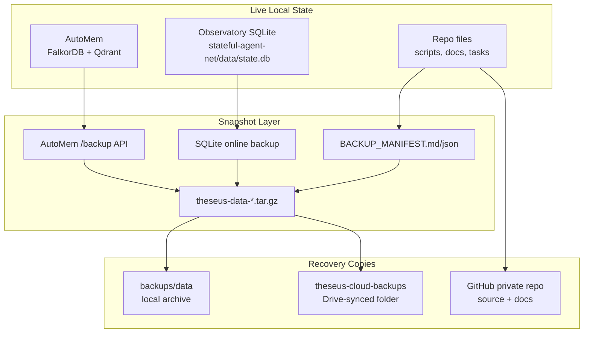
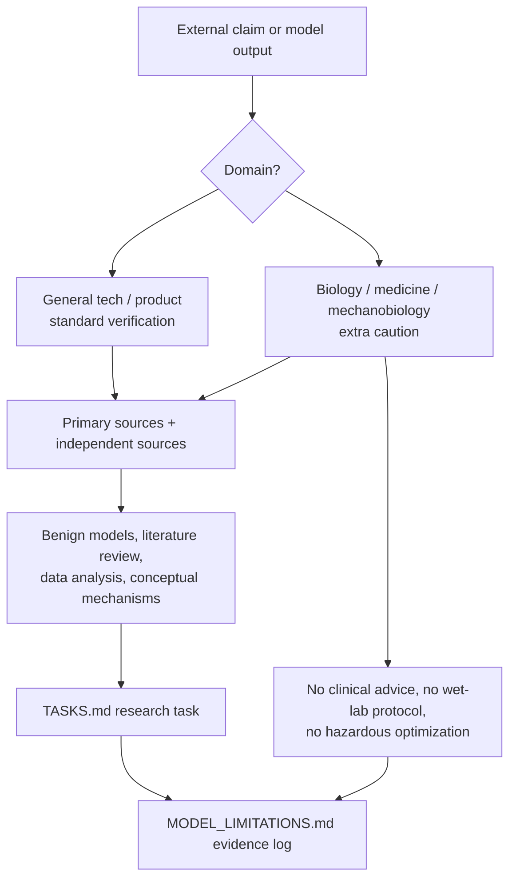
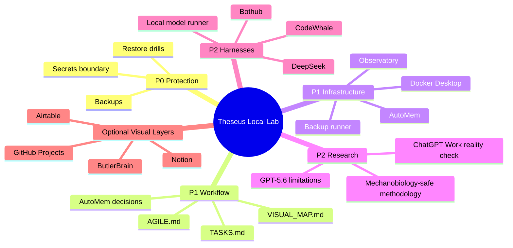

# Theseus Local Lab Visual Map

This is the visual layer for the repo-native workflow. It should stay simple:
Mermaid diagrams are readable in Markdown, versioned in Git, and easy for Codex
to update without adding another service.

## Operating System

## Kanban Flow

## Priority Matrix

## Memory And Backup Circuit

## Research Safety Funnel

## Current Focus

