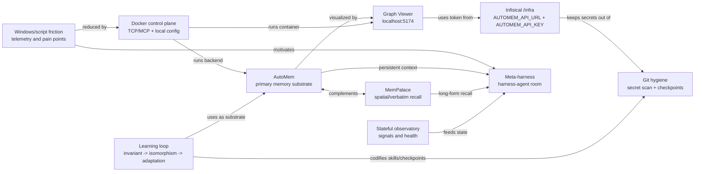

# AutoMem Graph Analysis 2026-07-13

Source: local AutoMem `/graph/snapshot` via Infisical `/infra`.

## Snapshot

- Nodes: 140
- Edges: 769
- Selected high-degree semantic slice: 30 nodes, 100 edges
- Main relationship types:
  - `PRECEDED_BY`: 685
  - `REINFORCES`: 30
  - `PART_OF`: 20
  - `DERIVED_FROM`: 11
  - `RELATES_TO`: 11
  - `EVOLVED_INTO`: 9
  - `EXEMPLIFIES`: 3

## Interpretation

The graph is dense enough to be useful as an exocortex map. Most edges are
temporal, so a second semantic projection is needed for navigation: memory,
tooling, harness, observatory, methodology, and continuity.

Key hubs:

- AutoMem: primary graph-vector memory substrate.
- Meta-harness: target architecture for a room of harnessed agents.
- Windows/script friction: first-class telemetry that motivates Unix-like and
  Docker control planes.
- Docker control plane: shared runtime for AutoMem, Graph Viewer, CodeWhale,
  logs, backups, and future agents.
- Stanford/ButlerBrain/TID/HADI: methodology cluster for learning loops and
  trace discipline.

## Local Semantic Map



## Ace Knowledge Graph Attempt

Ace Knowledge Graph was tried twice:

- full semantic slice
- compact core graph

Both attempts timed out at the plugin endpoint. The local slice remains saved at:

```text
outputs/graph_analysis/automem_ace_slice_2026-07-13.json
```

Retrying Ace later should use the compact core graph first.

## Wolfram Core Graph Analysis

Wolfram Language was run on the compact 10-node semantic core graph.

Core metrics:

- Vertices: 10
- Edges: 13
- Undirected density: 0.2889
- Connected: true
- Diameter: 4
- Mean graph distance: 2.0667

Top degree nodes:

1. AutoMem: 5
2. Meta-harness: 4
3. Graph Viewer: 3
4. Docker control: 3
5. Windows friction: 2

Top betweenness nodes:

1. AutoMem: 18.17
2. Meta-harness: 10.33
3. Graph Viewer: 6.83
4. Learning loop: 5.17
5. Docker control: 3.67

Top closeness nodes:

1. AutoMem: 0.6923
2. Meta-harness: 0.5625
3. Graph Viewer: 0.5625
4. Docker control: 0.5294
5. MemPalace: 0.5

Top PageRank nodes:

1. Meta-harness: 0.1985
2. Git hygiene: 0.1824
3. Infisical keychain: 0.1352
4. Graph Viewer: 0.1033
5. AutoMem: 0.0962

Detected communities:

1. AutoMem, MemPalace, Meta-harness, Stateful observatory
2. Graph Viewer, Docker control, Windows friction
3. Infisical keychain, Learning loop, Git hygiene

K-core:

- 1-core: all 10 nodes
- 2-core: all except Stateful observatory
- 3-core and 4-core: none

Interpretation:

- AutoMem is the strongest bridge and local center of reachability.
- Meta-harness is the strongest sink/attractor: many flows terminate in the
  future multi-agent operating model.
- The observatory is currently peripheral in the compact semantic graph. It
  should gain more explicit links to Docker, logs, memory hooks, and agent
  health if it is meant to become a default state layer.
- The keychain/git-hygiene/learning-loop cluster is coherent and important, but
  risks becoming a narrow chain. More cross-links to Docker, AutoMem, and
  Graph Viewer would make it less brittle.
- No 3-core means the current semantic projection is still a navigable scaffold,
  not yet a highly redundant mesh. That is fine for an early exocortex, but it
  shows where resilience work should go next.
