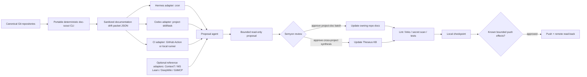

# Documentation Automation Architecture Audit — 2026-08-30

## Executive summary

Theseus currently has a useful curated Markdown knowledge base and a working deterministic staleness detector, but it does **not** yet have a documentation lifecycle. The existing Hermes cron job only emits a reminder. It does not run an agent, create a proposal, update project documentation, or publish the knowledge base.

The target must serve more than Hermes. Git, Markdown, a versioned shared contract, and a portable CLI/CI route should form the baseline. Hermes MCP tools and cron are optional adapters. Codex and future agents must be able to run the same workflow without importing Hermes runtime configuration.

The first pilot should **not** deploy an AI wiki service or write MCP wrappers. It should build a deterministic cross-repository documentation inventory and drift packet, then let an agent turn that packet into a bounded, read-only proposal. Publication remains a separate human-approved stage.

## Scope and evidence boundary

This is an architecture map and debt report, not an implementation order.

Reviewed local evidence:

- `docs/plans/documentation_audit.md`;
- `docs/reference/workspace-registry.yaml`;
- `docs/reference/infrastructure-registry.yaml`;
- `D:/theseus-knowledge-base/{AGENTS.md,README.md,PROJECT_MAP.md,Home.md,SCHEMA.md,index.md,_Sidebar.md,log.md}`;
- Hermes cron job `7a5650d7a926` and `kb_timeline_reminder.py`;
- live Hermes MCP inventory;
- local Git state for `D:/theseus-knowledge-base`.

External evidence is limited to public official documentation and public repository READMEs. It is reference material, not authority for Theseus runtime state.

## Current state

| Layer | Current state | Evidence | Assessment |
|---|---|---|---|
| Project documentation | Markdown is distributed across canonical repositories | `documentation_audit.md` | Present but not inventoried or drift-checked |
| Curated cross-project KB | Clean private Git repository at `D:/theseus-knowledge-base`; `main == origin/main`; HEAD `c8f670a` | Git read-only check | Healthy publication target |
| KB schema | Frontmatter, FACT/INFERENCE/HYPOTHESIS/UNKNOWN and lifecycle labels, index/log discipline | `SCHEMA.md` | Strong and should remain authoritative |
| Staleness detection | Daily Hermes script measures KB age, sessions, turns, artifacts, commits and dirty sources | `kb_timeline_reminder.py` | Detector works |
| Reminder delivery | Cron output exists for 11 runs; alerts were emitted on 2026-08-29 and 2026-08-30 | `cron/output/7a5650d7a926/` | User-visible delivery ineffective |
| Agent proposal | Cron has `no_agent: true` | `cron/jobs.json` | Absent by design |
| Documentation writer | `knowledge-base-publication` skill | Hermes runtime skill | Strong final-stage safety contract; not a continuous scout |
| Portable shared workflow | None found | Canonical repositories | Missing |
| CI documentation checks | No `.github/workflows/` directories found in the three inspected canonical repositories | File inventory | Missing |
| Markdown/link automation | Schema requires checks, but no checked-in runner was found | Content search | Contract exists; motor is missing |
| External repo references | DeepWiki, Context7, Microsoft Learn are enabled in Hermes; GitMCP works ad hoc through mcporter | Live discovery | Useful read-only adapters, not writers |

## Why the current cron does not maintain documentation

The job is named `Theseus KB timeline reminder`, but its effective contract is script-only:

```text
no_agent: true
script: kb_timeline_reminder.py
deliver: origin
origin: null
```

`no_agent: true` means the job prompt is not executed by an agent. The script explicitly states that it never edits, commits, pushes or publishes. Therefore a successful run proves only that the probe completed. It cannot produce an evidence review, candidate pages or a Wiki update.

The detector emitted real alerts:

- 2026-08-29: 15,187 conversation turns, 30 active sessions, 27 source commits after markers;
- 2026-08-30: KB age 7.2 days, 17,216 turns, 37 sessions, 27 source commits.

Those alerts were saved as cron output, but the job has no concrete captured origin. `last_delivery_error: null` is not proof that the user saw a continuable message.

## Autodocumentation is five different capabilities

### 1. Extract

Generate mechanical reference from code: public APIs, symbols, configuration schemas and command references.

Typical tools:

- `mkdocstrings` for source-driven MkDocs reference;
- TypeDoc for TypeScript;
- Sphinx/autodoc for Python-heavy projects;
- Doxygen for C/C++ and mixed native code.

This is deterministic or semi-deterministic reference generation. It does not explain architecture or decisions.

### 2. Detect drift

Identify documentation whose evidence boundary has changed:

- source commits after the page marker;
- public API/schema changes;
- configuration changes;
- broken links;
- stale `updated` dates;
- runtime claims whose postconditions are no longer verified;
- new incidents, issues or decisions without a curated page.

The existing Hermes script is an early local detector, but it is not portable and has no versioned source owner.

### 3. Synthesize

Turn bounded evidence into architecture, decisions, timelines, audits and runbooks. This is an agent task with explicit provenance and epistemic labels. It must preserve contradictions and exclude raw transcripts, secrets and bulk runtime output.

### 4. Publish and render

Validate and expose reviewed Markdown:

- commit in the owning repository;
- update `index.md`, `_Sidebar.md` and `log.md` for the KB;
- optionally render with MkDocs/Pages;
- push only under the approved Git workflow;
- perform remote read-back.

### 5. Retrieve

Give agents current repository and library documentation. DeepWiki, GitMCP, Context7 and Microsoft Learn primarily belong here. Retrieval is not publication.

## Tool and MCP classification

| Tool | Primary role | Portable route | Write capability | Theseus use |
|---|---|---|---|---|
| DeepWiki official MCP | Generated public-repo Wiki and grounded Q&A | Official HTTP MCP; native Hermes works; direct mcporter timed out in the observed probe | No | Optional reference for public repos; not baseline until portable parity is stable |
| Context7 | Version-specific library/API documentation | Official Streamable HTTP; mcporter discovery verified | No | Reference during project doc synthesis; not a project Wiki |
| Microsoft Learn MCP | Official Microsoft/Azure documentation and samples | Official HTTP; mcporter discovery verified | No | Domain-specific authoritative evidence only |
| GitMCP | Read public GitHub docs/code as MCP | Repo-scoped HTTP; mcporter discovery verified | No | Portable public-repo fallback shared by Hermes/Codex/other agents |
| `knowledge-base-publication` | Curated publication, provenance, validation, Git/read-back gates | Skill is Hermes runtime today; contract can be projected to other harnesses | Yes, after approval | Final writer/publisher, not scout |
| `llm-wiki` | Generic interlinked Markdown KB workflow | Skill/runtime dependent | Local Markdown writes | Reference principles only; its default structure does not replace Theseus `SCHEMA.md` |
| Google Code Wiki | Continuously generated hosted wiki, diagrams and repo-aware chat | Google-hosted public preview | Maintains its own hosted knowledge layer | Strong product reference; public repos only today; private Gemini CLI extension still coming soon |
| FSoft-AI4Code/CodeWiki | Multilingual repository-level Markdown/diagram generation | MIT Python CLI, Docker and MCP | Writes Markdown/metadata; supports incremental updates | Strong portable spike candidate; requires isolation, cost and credential controls |
| DeepWiki-Open / OpenDeepWiki | AI-generated repository docs, chat and optional MCP | Self-hosted application/container | Generates its own knowledge layer | Potential future isolated pilot; infrastructure and privacy review required |
| MkDocs + mkdocstrings | Build/render Markdown and source-derived API reference | CLI/container/CI | Generates site/reference artifacts | Strong portable renderer/reference candidate; not an AI curator |
| Sphinx / Doxygen / TypeDoc | Language-specific API/reference generation | CLI/container/CI | Generates reference artifacts | Optional per-project adapters; none is a cross-project narrative writer |
| Backstage TechDocs | Multi-repo docs-as-code catalog and CI publication | `techdocs-cli` plus Backstage service | Builds/publishes docs sites | Excessive infrastructure for the current hobby lab unless project count and team needs grow materially |
| Mintlify / GitBook / ReadMe | AI-assisted documentation drafting and hosted publication | Vendor SaaS/Git integrations | Write-capable with review workflows | Not a foundation for the private local KB because repository content and drafts enter a cloud service |

## External evidence notes

### MkDocs and mkdocstrings

FACT: mkdocstrings injects documentation collected from source into MkDocs pages and supports language handlers. Material for MkDocs documents GitHub Actions and `mkdocs gh-deploy` publication.

INFERENCE: MkDocs is a good optional renderer and API-reference surface for Theseus because it preserves Markdown/Git portability. It should consume project-owned documentation, not become a second authoring source.

Sources:

- https://mkdocstrings.github.io/
- https://squidfunk.github.io/mkdocs-material/publishing-your-site/

### Backstage TechDocs

FACT: TechDocs keeps Markdown near code, uses `mkdocs.yml`, `catalog-info.yaml` and `techdocs-cli`, and normally publishes generated sites through CI to object storage for a Backstage instance.

INFERENCE: its catalog model is architecturally relevant, but operating Backstage and storage publication would be disproportionate for the current lab.

Sources:

- https://backstage.io/docs/features/techdocs/creating-and-publishing/
- https://backstage.io/docs/features/techdocs/configuring-ci-cd/

### DeepWiki and GitMCP

FACT: official DeepWiki MCP exposes `read_wiki_structure`, `read_wiki_contents` and `ask_question` for public repositories. Private repositories require a Devin account. GitMCP exposes repository documentation/code through repo-scoped remote MCP and can be self-hosted.

INFERENCE: both are reference adapters. Neither should own or silently update the private Theseus KB.

Sources:

- https://docs.devin.ai/work-with-devin/deepwiki-mcp
- https://github.com/mcp/cognitionai/deepwiki
- https://github.com/idosal/git-mcp

### Context7 and Microsoft Learn

FACT: Context7 supplies current version-specific library documentation; Microsoft Learn supplies first-party Microsoft documentation and code samples.

INFERENCE: they should be called only when a candidate page depends on those domains. Always exposing their schemas to every documentation run is unnecessary; portable HTTP/mcporter calls can be used by harness adapters.

Source:

- https://context7.com/docs/overview
- https://learn.microsoft.com/api/mcp

### Self-hosted AI Wiki generators

FACT: DeepWiki-Open and OpenDeepWiki can analyze Git repositories and generate structured documentation. OpenDeepWiki includes Docker Compose, background incremental workers, a database, provider credentials, a public site and MCP endpoints.

UNKNOWN: the reviewed material does not prove that either product can export an incrementally reviewed Markdown patch directly into the existing Theseus KB schema. They primarily maintain their own generated knowledge layer.

INFERENCE: they are full applications, not lightweight CLIs. Any pilot would create a new infrastructure stack and must first receive an infrastructure-registry entry, owner, data boundary, model-cost boundary, recovery policy and deletion policy. They are not the first pilot and must not be treated as automatic writers to `D:/theseus-knowledge-base` without an export/read-back proof.

Sources:

- https://github.com/AsyncFuncAI/deepwiki-open
- https://github.com/AIDotNet/OpenDeepWiki

### Commercial AI documentation writers

FACT: Mintlify, GitBook and ReadMe advertise AI-assisted drafting or editing tied to hosted documentation products and Git review workflows.

INFERENCE: they may be useful references for proposal/review UX, but they are not suitable as the portable baseline for a private local knowledge base unless a separate cloud-data decision authorizes that boundary.

### Google Code Wiki

FACT: Google Code Wiki is a public-preview hosted system that ingests public repositories, continuously regenerates documentation after changes, links explanations to code definitions, generates architecture/class/sequence diagrams, and provides Gemini-powered repository chat.

FACT: Google's official site still labels private-repository support as `Coming Soon`. The official announcement says a Gemini CLI extension for local and secure internal repositories is under development and links to a waitlist.

UNKNOWN: no official Code Wiki CLI extension repository, MCP server, general API or Markdown export path was found in the reviewed official Google sources. A community `codewiki-mcp` exists, but it is not a Google-owned integration.

INFERENCE: Google Code Wiki is currently a strong UX and architecture reference and may be useful for public-repository reconnaissance, but it is not a portable foundation for private Theseus repositories.

Sources:

- https://developers.googleblog.com/introducing-code-wiki-accelerating-your-code-understanding/
- https://codewiki.google/

### FSoft-AI4Code/CodeWiki

FACT: FSoft-AI4Code/CodeWiki is an MIT-licensed Python CLI for repository-level documentation across Python, Java, JavaScript, TypeScript, C, C++, C#, Kotlin, PHP and Ruby. It generates Markdown, module metadata and Mermaid visual artifacts and supports custom output, module focus, include/exclude filters, incremental updates, commit-based comparison, optional GitHub Pages output and optional branch creation.

FACT: it supports API providers as well as Claude Code and Codex CLI subscription modes, stores credentials in the system keychain with a file fallback, and includes Docker and MCP surfaces.

INFERENCE: it is the strongest reviewed portable AI-generator candidate because the core contract is a CLI over Git/Markdown rather than a Hermes-only tool. A first experiment must run in a disposable worktree or sanitized repository copy with a pinned revision, custom output directory, no branch creation, bounded model budget, no secrets and exact output review.

RISK: Claude/Codex subscription modes inherit harness-specific login and configuration surfaces. Theseus must not use them by default after the observed Codex identity leak into Hermes. Prefer an explicit isolated provider route or local model for any spike.

Sources:

- https://github.com/FSoft-AI4Code/CodeWiki
- https://arxiv.org/abs/2510.24428

### Hermes Skill Hub references

FACT: Skill Hub contains community skills for generic documentation, Diátaxis writing, code-first wiki generation, CodeWiki CLI operation and wiki linting. No skills were installed during this audit.

- `skills-sh/anthropics/knowledge-work-plugins/documentation` provides concise document-type and maintenance principles.
- `skills-sh/github/awesome-copilot/documentation-writer` provides a Diátaxis workflow, but its mandatory interactive clarification/outline approval is unsuitable for an unattended scout.
- `clawhub/codewiki-generator` includes a code-first analyzer → structured metadata → plan → VitePress workflow.
- `clawhub/codewiki` wraps FSoft-AI4Code/CodeWiki and optional MkDocs/VitePress rendering.
- `skills-sh/ar9av/obsidian-wiki/wiki-lint` is a candidate lint reference; its full supporting implementation was not installed or audited.

INFERENCE: these skills are useful design references, not trusted dependencies. Any adoption requires source inspection, security audit, pinned provenance and a harness-neutral project source. Community Skill Hub content must not become the only workflow definition.

## Skill audit

### `knowledge-base-publication`

Strengths:

- resolves the real destination before writing;
- adapts to the destination's schema;
- distinguishes remote, local-unpushed, generated, temporary and secret-risk sources;
- requires bounded batches, provenance, lifecycle labels, index/log updates, validation and remote read-back;
- separates source-repo dirt from KB publication.

Gaps for continuous documentation:

- no deterministic repository inventory or drift contract;
- no candidate-page scoring;
- no cross-repository marker format;
- no read-only proposal artifact;
- no shared harness-neutral interface;
- no mapping from code/API changes to owning project docs;
- assumes publication work has already been selected and approved.

Verdict: retain it as the final publication gate. Do not overload it into the scout.

### `llm-wiki`

Useful principles:

- orientation before search;
- query existing content before adding;
- cross-linking;
- explicit disputed/confidence state;
- lint and link validation.

Boundary:

- its generic information architecture must not replace `D:/theseus-knowledge-base/SCHEMA.md`;
- it is a reference for the shared contract, not an automatic migration target.

## Target architecture



## Ownership and harness boundaries

### Shared project source

A future shared contract should define capabilities, not Hermes tool names:

```text
inventory repositories
compute documentation drift
emit sanitized JSON packet
score candidate documentation work
validate Markdown/frontmatter/links
produce provenance manifest
```

The contract and schema belong in versioned project source. Candidate location requires a separate decision; no new files or directories are prescribed by this audit.

### Harness adapters

- Hermes: cron consumes the portable scout output and emits a continuable proposal.
- Codex: project skill or task invokes the same scout and follows the same proposal schema.
- CI: runs deterministic inventory/validation; it should not publish AI-generated synthesis without review.

Runtime MCP names, tokens, OAuth state and `$HERMES_HOME` paths must remain out of the shared contract.

### Infrastructure adapters

A custom wrapper, long-running service, container or authenticated remote adapter belongs to `D:/theseus-infrastructure` only after registry classification. No wrapper was created during this audit.

## Proposed minimal pilot

### Phase 0 — complete the documentation inventory

Follow `docs/plans/documentation_audit.md` for `theseus-local-lab` and produce the already-required inventory/debt report. This establishes page ownership and duplicate/stale claims before automation.

### Phase 1 — define one portable drift packet

Create a schema before code. Candidate fields:

```json
{
  "repo_id": "canonical registry id",
  "head": "commit sha",
  "remote_marker": "last published source marker",
  "dirty_paths": [],
  "documentation_files": [],
  "source_changes": [],
  "broken_links": [],
  "stale_pages": [],
  "candidate_topics": [],
  "evidence": [],
  "generated_at": "timestamp"
}
```

The packet contains pointers and counts, never raw transcripts or secrets.

### Phase 2 — local deterministic scout

Implement one CLI against one canonical repository and the KB. It performs no writes outside an ignored run-artifact directory. Verification requires stable JSON for unchanged inputs and explicit error classes.

### Phase 3 — two harness adapters

- Hermes cron reads the packet and produces a continuable bounded proposal.
- Codex project task reads the same packet and produces the same proposal shape.

This phase proves portability before any CI or MCP wrapper work.

### Phase 4 — approved publication

Use `knowledge-base-publication` only after Semyon approves the candidate batch. Keep project docs in their owning repositories; publish only stable cross-project synthesis to the KB.

### Optional Phase 5 — isolated AI-generation spike

- use a pinned FSoft-AI4Code/CodeWiki revision in a disposable worktree or sanitized repository copy;
- choose one small public or non-sensitive repo/module;
- set an explicit output directory outside canonical `docs/`;
- disable branch creation and automatic publication;
- use a bounded explicit provider route, not inherited Claude/Codex subscription mode;
- compare generated claims against code evidence and the existing documentation inventory;
- keep or discard the spike only after human review; do not register an infrastructure service for a failed experiment.

### Deferred

- GitHub Actions for drift checks;
- MkDocs rendering or Pages publication;
- source-driven API reference generation;
- self-hosted OpenDeepWiki/DeepWiki-Open;
- custom MCP/mcporter wrappers;
- automatic commits or pushes.

## Decision gates

1. Which canonical repository is the first scout pilot: `theseus-local-lab` is the default recommendation.
2. Where should the harness-neutral schema and scout source live?
3. Should the first agent proposal update only project docs, only the cross-project KB, or classify both without writing?
4. Which delivery target should Hermes use for continuable proposals?
5. Is MkDocs desired as a renderer, or should GitHub Markdown remain the only rendered surface during the pilot?
6. What evidence threshold promotes a project change into the cross-project KB?

## Current recommendation

Start with **inventory + drift packet + proposal**, not automatic page generation. Keep Git/Markdown and a shared CLI contract at the center. Use MCP tools only as bounded reference adapters. Keep `knowledge-base-publication` as the reviewed writer. Do not modify the current cron until the portable scout contract exists.
