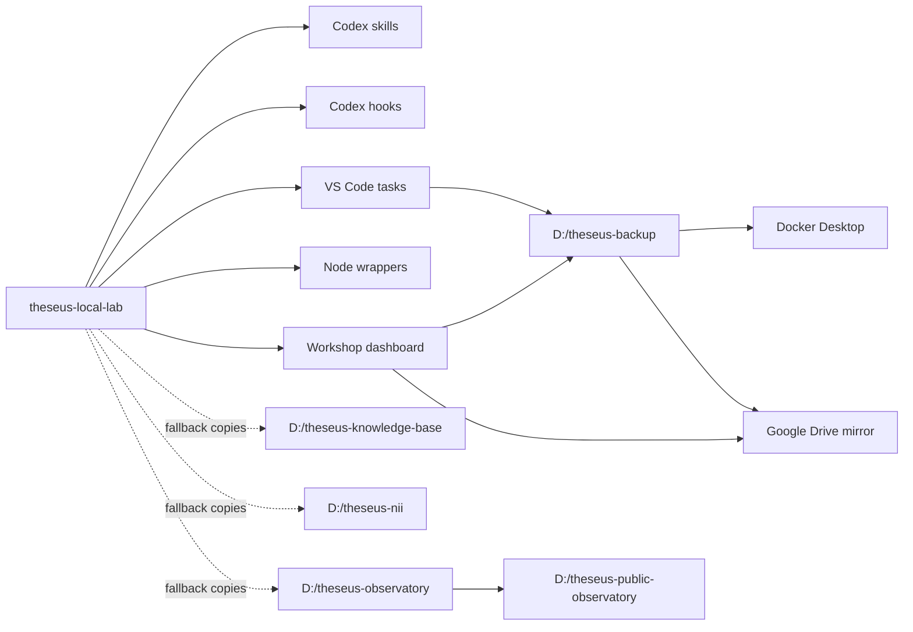

# Theseus Project Split Graph Audit

Status: active cleanup plan.

## Active Projects

| Project | Path | Role |
|---|---|---|
| Local lab monolith | `C:\Users\s.poklad\Documents\Codex\2026-07-08\life-science-research-plugin-life-science-4` | Core harness, skills, hooks, dashboards, fallback copies |
| Backup | `D:\theseus-backup` | Backup runner, restore notes, legacy archives, Google Drive mirror config |
| Knowledge base | `D:\theseus-knowledge-base` | Drive/chat corpus indexing, Graphify, OCR/source lenses |
| NII | `D:\theseus-nii` | CodeWhale, conclaves, A2A, local model workers |
| Observatory | `D:\theseus-observatory` | Local telemetry, Codex/system/GitHub issue watchers |
| Public observatory | `D:\theseus-public-observatory` | Public-facing observatory site/data surface |

## Current Runtime Edges

## Cleanup Targets

- VS Code tasks: replace monolith-local backup, observatory, Graphify, and
  corpus paths with active `D:\theseus-*` projects.
- Node wrappers: prefer active project paths and keep old monolith copies as
  explicit fallback only.
- Dashboard and service status: read active backup/observatory paths first.
- Skills: remove stale Windows/PowerShell bridges and update references to
  active projects.
- Hooks: audit for old monolith paths, old Docker bridge assumptions, and
  duplicated memory routes.
- Docker bridge: document current Windows API status and a WSL-safe route before
  enabling any always-on WSL bridge.
- Skills and hooks: audit both project-local and `C:\Users\s.poklad\.codex`
  configs for hardcoded monolith paths, old Docker bridges, and stale memory
  routes before switching the agent runtime to WSL.

## Docker API Bridge Finding

Windows Docker API currently responds on `http://127.0.0.1:2375/_ping` and the
Windows Docker CLI can use `DOCKER_HOST=tcp://127.0.0.1:2375`.

WSL cannot reach that raw daemon address because `127.0.0.1` resolves inside
WSL. `host.docker.internal:2375` and the WSL nameserver did not connect during
the initial probe.

The Docker socket proxy prototype in `D:\theseus-observatory` does work from
WSL at `http://127.0.0.1:23760` and blocks write operations with `403`. This is
the preferred read-only diagnostic bridge for WSL agents.

## Docker Proxy Research Update

See `docs/research/docker_wsl_agent_proxy_research_2026-07-16.md`.

Current recommendation:

- keep raw `tcp://127.0.0.1:2375` as a Windows-local legacy bridge only;
- use `D:\theseus-observatory\docker-proxy-lattice` for read-heavy WSL/agent
  diagnostics;
- keep privileged actions behind the Theseus Docker MCP/control-plane;
- optionally deploy Portainer CE as a human-facing Web UI, not as the narrow
  agent permission layer.

## Current Audit Findings

- `C:\Users\s.poklad\.codex\hooks.json` and project `.codex/hooks.json` still
  point to the monolith hook-router path. This is acceptable while the monolith
  remains the active harness, but it is not portable to WSL without a wrapper or
  generated config.
- `C:\Users\s.poklad\.codex\config.toml` still contains monolith paths for
  AutoMem MCP and Docker control-plane MCP.
- Some knowledge-tool README examples still point to old
  `C:\Users\s.poklad\Documents\Codex\2026-07-08` corpus paths. Those tools are
  now fallback-only in the monolith and active in `D:\theseus-knowledge-base`.
- WSL preflight is now a first-class wrapper:
  `node tools/wsl_migration_preflight/wsl_migration_preflight.mjs`.
  Current result is `WARN`, not `FAIL`: WSL sees Node/Git/GitHub CLI, all
  active `D:\theseus-*` projects, VS Code CLI, and the Docker socket proxy on
  `127.0.0.1:23760`. Remaining warnings are WSL SSH-agent, global Codex config
  portability, and legacy raw `2375` routes in VS Code tasks.

## WSL Migration Issue Scan

See `docs/research/codex_wsl_issue_scan_2026-07-16.md`.

Open upstream Codex issues align with our local symptoms:

- `CODEX_HOME` and SQLite/socket state can break when runtime state lives on
  `/mnt/c`.
- Windows config and UNC cwd can leak into WSL execution.
- Windows `TEMP/TMP` forwarding through `WSLENV` can break Linux tools.
- Browser/Chrome/Computer Use bridges and attachment paths are not proven WSL
  native.

Current recommendation:

- keep WSL as a guarded pilot and Unix tool layer;
- keep Codex runtime state Windows-native until WSL-native config/cache is
  explicitly prepared;
- fix or accept WSL SSH-agent as a pilot constraint before relying on SSH git;
- use WSL GitHub CLI HTTPS auth as the immediate Git fallback;
- run WSL preflight after each Codex update or environment switch.

## ACL Preparation

`CodexSandboxUsers` has full inherited access on active `D:\theseus-*`
projects. This prepares the next WSL/sandbox migration attempt without editing
per-project permissions again.
