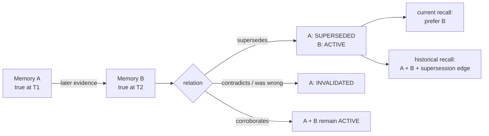
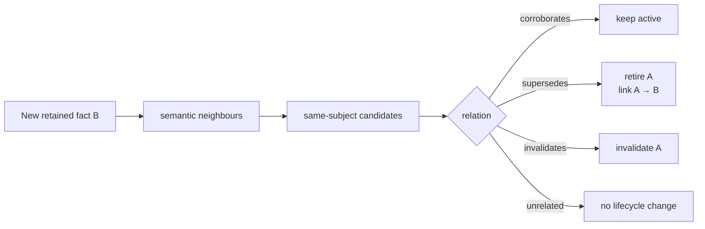

## Draft comment

Thanks — I agree with both objections. I was using **TTL** too loosely in the earlier proposal.

I do **not** think age should determine correctness. A fact does not become false because `N` hours passed, and I agree that deleting invalidated facts from the history can make later reconstruction worse.

The narrower gap I am trying to describe is this:

```text
invalidated  = the retained fact was wrong
superseded   = the retained fact was true, but later evidence replaced it as the current state
active       = still current
```



#3475 is the clean example. `autocommit=false` really was the project setting on one day; a later change removed/reversed that policy. Likewise, `agentmemory` really was a dependency before the project migrated away from it. The older memories are useful historical evidence, but they should not compete with the later state as equally-current guidance.

We hit the same shape again in a live Hermes/Hindsight workflow today. An older retained policy said that **local commit and push both require a separate user request**. The current project policy later changed to **local commit is an allowed checkpoint inside an approved bounded workflow; push is a separate downstream-effect gate**. Hindsight still had both historical memories. A correction ranked above the older one after we added it, but the retired rule remained retrievable and contributed to the agent selecting it again. The authoritative `AGENTS.md` / Git-hygiene policy corrected the action, but retrieval ranking was doing work that seems better represented explicitly as lifecycle.

So I would withdraw automatic `expires_at` and correctness-driven purge from the core request. A smaller possible model would be an explicit directed relation/state, for example:

```text
memory A --superseded_by--> memory B

A: historically valid, no longer current
B: current
```

Candidate matching could stay bounded: when a new fact is retained, use the existing semantic-neighbour/relationship machinery to find likely facts about the same subject, then classify the relation as something like `corroborates | contradicts | supersedes | unrelated`. Only an explicit `supersedes` result would retire the older fact. I am not proposing that vector distance or age alone make that decision.



The retrieval contract could then be testable:

```text
Given A was true at T1
and B is later evidence that supersedes A on the same subject,

current recall:
  returns B as current
  does not present A as competing current guidance

historical/audit recall:
  may return both A and B
  exposes that A was superseded by B
```

This preserves exactly the provenance/history concern you raised: nothing has to disappear. `invalidated` remains the right state for facts that were wrong when retained; `superseded` would cover facts that were correct and later ceased to describe the current state.

If time metadata is useful at all, I would now treat it only as a **review hint**, not validity. For example `review_after` could raise revalidation priority for classes of facts that historically change often. Even a learned survival/hazard estimate from prior supersession intervals would only answer *"what deserves another look?"*, never *"is this now false?"*.

### Possible implementation references (non-normative)

These are not dependencies of the proposal, just concrete algorithmic directions for experiments:

- **Directed/sparse lifecycle graph:** SciPy's `scipy.sparse.csgraph` provides sparse directed-graph primitives that are a reasonable prototype substrate for explicit `superseded_by` relations and graph traversal: https://docs.scipy.org/doc/scipy/reference/sparse.csgraph.html
- **Candidate grouping / subject neighbourhoods:** `scipy.cluster.hierarchy` provides hierarchical/agglomerative clustering (`linkage`, `fcluster`, etc.) that could be explored as a bounded candidate-grouping aid before relation classification: https://docs.scipy.org/doc/scipy/reference/cluster.hierarchy.html
- **Review priority, not validity:** SciPy supports censored observations and empirical survival functions; `scipy.stats.ecdf` uses Kaplan–Meier for right-censored data. That could estimate *when a class of facts deserves re-checking*, without making age a truth predicate: https://docs.scipy.org/doc/scipy/reference/generated/scipy.stats.ecdf.html and https://docs.scipy.org/doc/scipy/reference/generated/scipy.stats.CensoredData.html
- **Research-only hierarchical aboutness:** if Hindsight ever explores hierarchical semantic geometry, Geomstats exposes a Poincaré-ball model of hyperbolic space. I would treat this as a separate research direction for `aboutness` / hierarchy, not as part of this lifecycle feature: https://geomstats.github.io/api/geomstats.geometry.html

So the core proposal remains deliberately smaller:

```text
core correctness:     evidence-driven supersession
candidate generation: semantic neighbours / subject grouping
review scheduling:    optional age/hazard signal
hierarchical geometry: research only
```

And agreed on subject attribution — I would leave that with #3476 rather than broaden this issue again.

Does this narrower `active / superseded / invalidated` lifecycle match the distinction you were asking for, or is there already a Hindsight primitive that should represent the historically-true-but-retired case?

---
Prepared collaboratively by Semyon Poklad and Shut (ChatGPT / GPT-5.6 Sol). Submitted only after Semyon's manual review and explicit approval.
