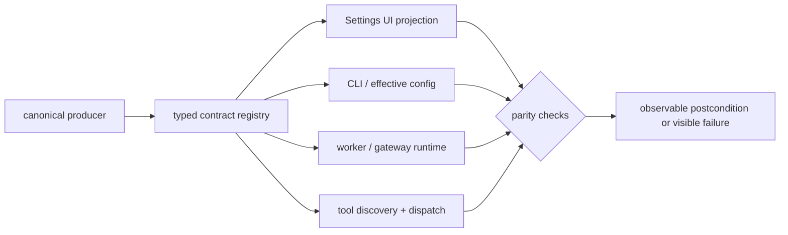

## Draft comment

## Additional cross-surface examples of producer/consumer contract drift

Several newer reports fit the producer→consumer pattern described here, beyond ordinary config-field propagation:

- #85668: the project registry identifies the intended workspace, while the Desktop process CWD selects a different `AGENTS.md`;
- #86530: live config/runtime uses a local provider endpoint while the Settings UI continues to render a default cloud endpoint;
- #84772: MCP discovery and `tool_search` expose tools that the main dispatch registry cannot call;
- #85622: documentation specifies additive built-in + external memory, while one provider activation path produced a different session result.

These issues should not be collapsed into one bug, but they strengthen the FR's central claim: producer and consumer bindings are implicit, path-specific and difficult to verify before a user hits the missed path.

A useful extension to the proposed parity tests may be to require each declared contract field/state to identify:

```text
canonical producer
expected consumers/projections
activation boundary
parity test across execution surfaces
observable postcondition
```

For example, project-primary and CWD should have a declared relationship; MCP tool discovery and callable dispatch should converge on one registry or fail visibly; UI values should be read from the same effective config/runtime projection that the service uses.



This remains complementary to #55811: this issue can prove that state/config reaches every intended consumer, while the runtime capability contract decides whether a high-risk action is authorized.

---
Prepared collaboratively by Semyon Poklad and Svarog, an AI engineering agent and engineering partner. Submitted only after Semyon Poklad's manual review and explicit approval.
