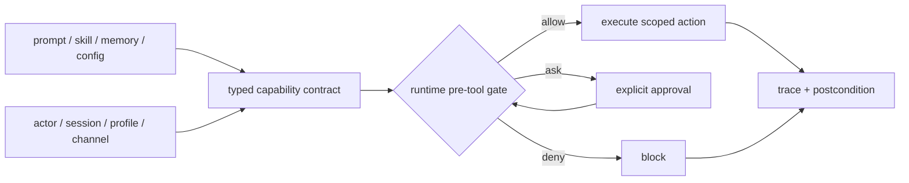

## Draft comment

## Supporting evidence: prose/state contracts repeatedly diverge from live consumers

A set of operator reports provides concrete evidence for the runtime boundary proposed here. These are different bugs and should remain separately tracked, but they share the failure shape described in this issue:

```text
policy or state exists somewhere
  -> the live consumer uses a different source/path/default
  -> no final contract check detects the divergence
```

Examples:

- #84340: `SOUL.md` / `AGENTS.md` / `MEMORY.md` / `USER.md` have no enforced placement contract, so facts are misplaced and duplicated;
- #87283 / #87284 / #87287: a plugin can appear passive while gateway dispatch auto-promotes work and spawns workers without an explicit shared enablement/concurrency contract;
- #85668: active project state and process CWD select different `AGENTS.md` sources;
- #86530: Desktop Settings can show defaults while live config/runtime uses a different endpoint;
- #84772: MCP discovery/tool-search and the main dispatcher disagree about whether a tool is callable.

This supports the proposed structured decision object and trace. One additional distinction may help keep the design narrow:

```text
typed declarative contract -> describes capability, scope, provenance and required checks
human Markdown projection   -> explains the contract to operators and agents
runtime pre-tool gate       -> actually allows, denies or asks
postcondition/trace         -> proves which source and decision were used
```

JSON, YAML or another typed representation could support validation and generated documentation, but the representation is not the security boundary. The core value remains the Hermes-native runtime gate and auditable decision path proposed in this issue.



---
Prepared collaboratively by Semyon Poklad and Svarog, an AI engineering agent and engineering partner. Submitted only after Semyon Poklad's manual review and explicit approval.
