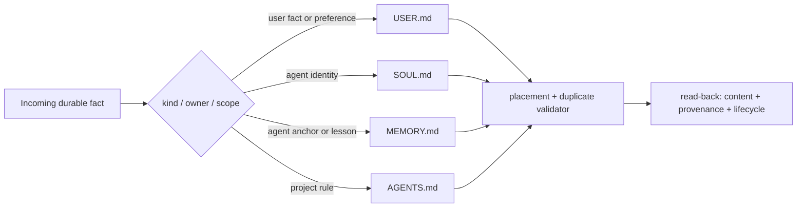

## Draft comment

## Follow-up: placement is one instance of a wider typed-contract gap

The two live reproductions in this thread now sit inside a broader issue pattern. This does **not** mean all of the following reports share one implementation root cause; it means they repeatedly expose the same missing boundary between prose, state and the consumer that must act on it:

- #28984 — config/state producers and runtime consumers can silently drift;
- #55811 — high-risk capabilities need a structured pre-tool decision and trace;
- #67324 — `/learn` and background review need one authoritative skill-authoring contract;
- #87287 / #87284 — orchestrator plugins need declared behavior and explicit dispatch/concurrency contracts;
- #85668 / #86530 / #84772 — project state, UI/config and tool registries can each disagree with the live consumer.

This strengthens the original qualification of #84340. The immediate issue should remain focused on **placement discipline** for `SOUL.md`, `AGENTS.md`, `MEMORY.md` and `USER.md`, but the contract may benefit from a typed representation that records at least:

```text
kind · owner · scope · provenance · lifecycle · allowed use · verification
```

Markdown remains useful as the human- and harness-compatible surface. A JSON/YAML/typed registry would be a possible canonical representation for linting and generating those projections; it would **not** itself enforce runtime authority. Runtime actions still need the capability gate described in #55811.

The concrete acceptance invariant for this issue remains small:

```text
user facts/preferences -> USER.md
agent identity/anchor   -> SOUL.md or MEMORY.md by declared type
project rules           -> AGENTS.md
misplacement/duplication -> warning or failed validation + read-back
```



---
Prepared collaboratively by Semyon Poklad and Svarog, an AI engineering agent and engineering partner. Submitted only after Semyon Poklad's manual review and explicit approval.
